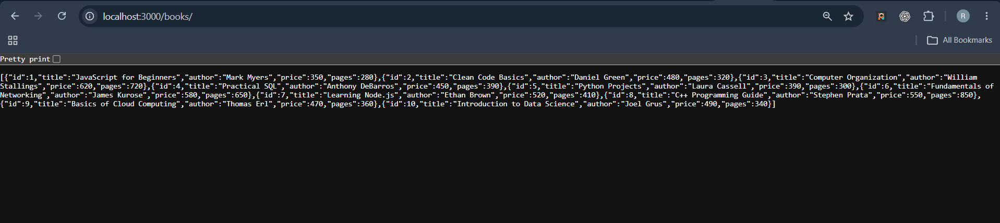
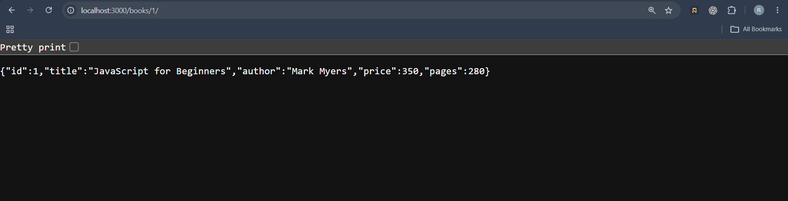
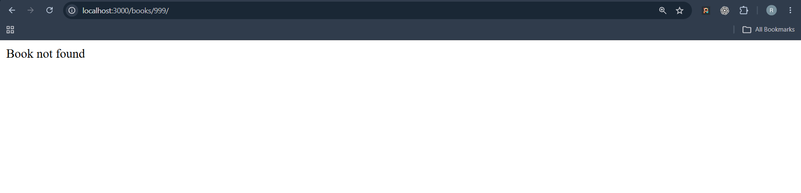
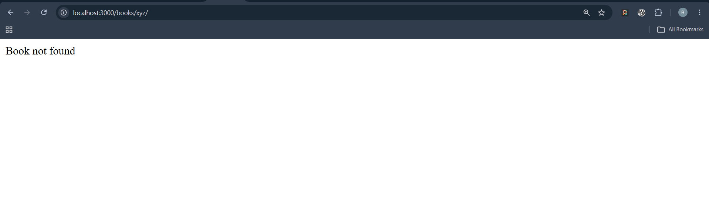
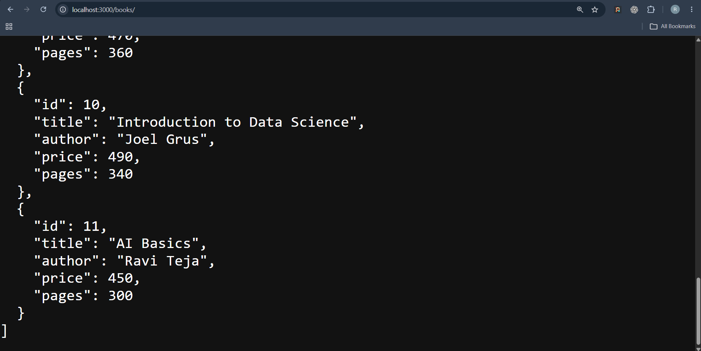
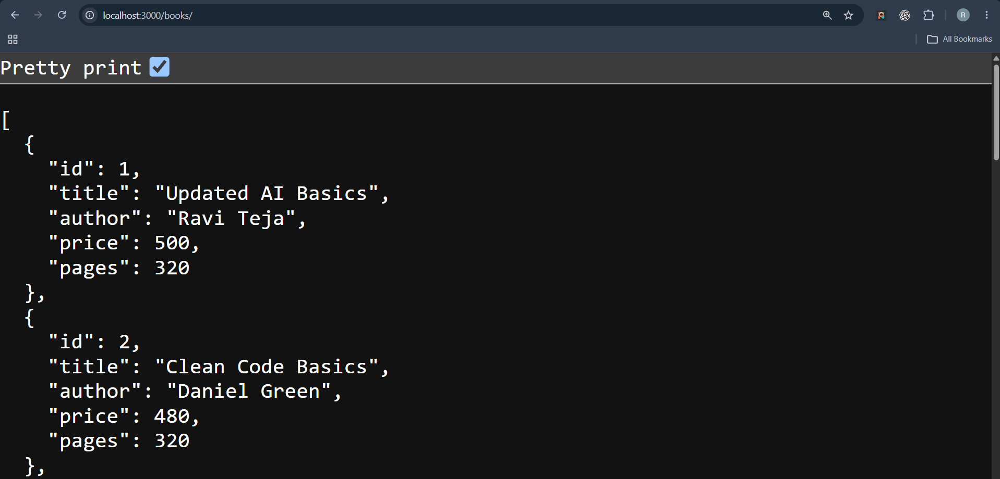
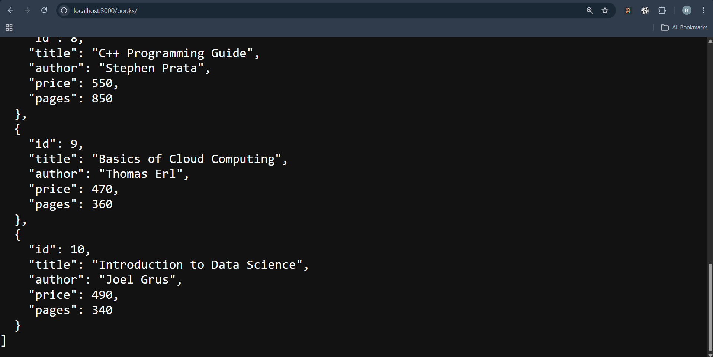
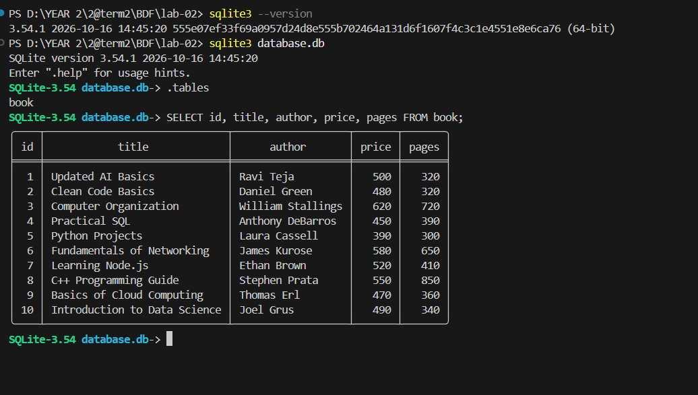

# Lab 2: SQLite Database and CRUD Routes

## Student Details

- **Name:** Valluri Ravi Teja
- **Registration Number:** 252U1R9166
- **Section:** CSE GEN-AI 2C
- **Institution:** Aurora University
- **Course:** Backend Development Fundamentals
- **Faculty:** Joel Prashanth D

---

## 🚀 Deployed Application

The API is live and accessible at:

**https://backend-development-fundamentals-1-x9qa.onrender.com/**

You can test the endpoints directly using the base URL above. For example:

- **GET all books:** https://backend-development-fundamentals-1-x9qa.onrender.com/books/
- **GET single book:** https://backend-development-fundamentals-1-x9qa.onrender.com/books/1/

> **Note:** The server is hosted on Render's free tier. It may take 30–60 seconds to wake up on the first request.

---

## Objective

The objective of this lab is to connect an Express.js server with an SQLite database and implement CRUD operations (Create, Read, Update, Delete) using HTTP routes. The application uses asynchronous JavaScript with `async/await` and parameterized SQL queries to manage book records.

---

## Technologies Used

- **Node.js** - JavaScript runtime environment
- **Express.js** - Web framework for creating API routes
- **SQLite3** - Relational database for storing book records
- **sqlite** - Promise-based wrapper for asynchronous database operations
- **nodemon** - Automatically restarts the server during development
- **Postman / Thunder Client** - For testing API endpoints

---

## Project Structure

```text
BDF LAB-2/
├── screenshots/
│   ├── get-all-books.png
│   ├── get-single-book.png
│   ├── get-book-404.png
│   ├── invalid-id-400.png
│   ├── post-create-book.png
│   ├── put-update-book.png
│   ├── delete-book.png
│   └── sqlite-cli-verification.png
├── database.db
├── package.json
├── package-lock.json
├── README.md
├── seed.sql
└── server.js
```

---

## Installation and Execution

### 1. Navigate to the Lab 2 Directory

```bash
cd "BDF LAB-2"
```

### 2. Install Dependencies

```bash
npm install
```

### 3. Start the Server

Development mode:

```bash
npm run dev
```

Normal mode:

```bash
npm start
```

The server runs at:

```text
http://localhost:3000
```

---

## Database Schema

The application uses a table named `book` in the SQLite database `database.db`.

```sql
CREATE TABLE IF NOT EXISTS book (
    id INTEGER PRIMARY KEY AUTOINCREMENT,
    title TEXT NOT NULL,
    author TEXT NOT NULL,
    price INTEGER NOT NULL,
    pages INTEGER NOT NULL
);
```

The table stores the book ID, title, author, price, and number of pages.

---

## API Endpoints

| HTTP Method | Endpoint | Description | Success Status |
|---|---|---|---|
| GET | `/books/` | Retrieve all books | 200 OK |
| GET | `/books/:bookId/` | Retrieve a book by ID | 200 OK |
| POST | `/books/` | Add a new book | 201 Created |
| PUT | `/books/:bookId/` | Update an existing book | 200 OK |
| DELETE | `/books/:bookId/` | Delete a book | 200 OK |

The API handles invalid IDs, missing fields, and books that do not exist using appropriate error responses.

---

## Sample Requests

### 1. Create a Book - POST `/books/`

Request body:

```json
{
  "title": "Introduction to Web Development",
  "author": "David Miller",
  "price": 400,
  "pages": 350
}
```

### 2. Update a Book - PUT `/books/11/`

Request body:

```json
{
  "title": "Updated Web Development",
  "author": "David Miller",
  "price": 450,
  "pages": 380
}
```

For POST and PUT requests, select **Body → raw → JSON** in Postman or Thunder Client.

---

## Testing the API

Test the following operations using Postman or Thunder Client.

**Local (development):**

1. **GET all books:** `http://localhost:3000/books/`
2. **GET a single book:** `http://localhost:3000/books/1/`
3. **GET a nonexistent book:** `http://localhost:3000/books/999/`
4. **POST a new book:** `http://localhost:3000/books/`
5. **PUT an existing book:** `http://localhost:3000/books/11/`
6. **DELETE a book:** `http://localhost:3000/books/11/`

**Deployed (Render):**

1. **GET all books:** `https://backend-development-fundamentals-1-x9qa.onrender.com/books/`
2. **GET a single book:** `https://backend-development-fundamentals-1-x9qa.onrender.com/books/1/`
3. **GET a nonexistent book:** `https://backend-development-fundamentals-1-x9qa.onrender.com/books/999/`
4. **POST a new book:** `https://backend-development-fundamentals-1-x9qa.onrender.com/books/`
5. **PUT an existing book:** `https://backend-development-fundamentals-1-x9qa.onrender.com/books/11/`
6. **DELETE a book:** `https://backend-development-fundamentals-1-x9qa.onrender.com/books/11/`

Verify the HTTP status codes and JSON responses for each operation. After deleting a book successfully, a GET request for the same ID should return `404 Not Found`.

---

## Screenshots

### 1. Get All Books



### 2. Get Single Book



### 3. Book Not Found (404)



### 4. Invalid Book ID (400)



### 5. Create Book (POST)



### 6. Update Book (PUT)



### 7. Delete Book (DELETE)



### 8. SQLite CLI Verification



---

## Conclusion

In this lab, I connected an Express.js application to an SQLite database and implemented CRUD API routes for managing book records. I practised asynchronous database operations, parameterized SQL queries, HTTP methods, and API testing.
