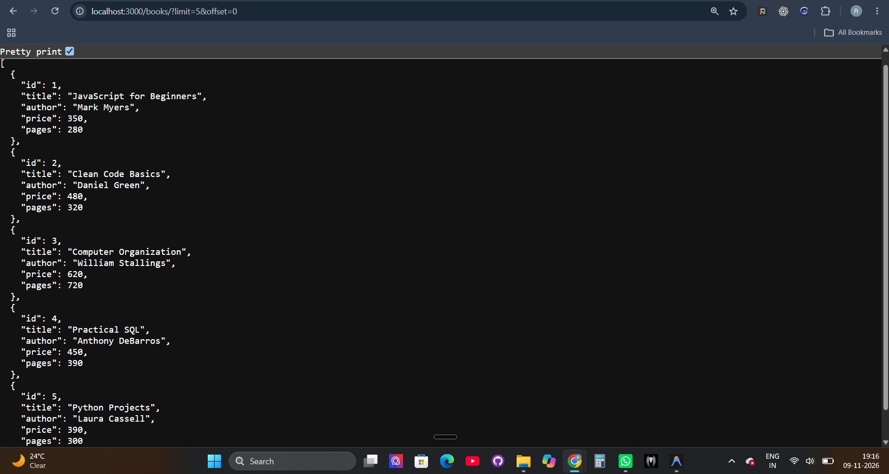

# Lab 3: Advanced REST API with Query Parameters and Validation

## Student Details

- **Name:** Valluri Ravi Teja
- **Registration Number:** 252U1R9166
- **Section:** CSE GEN-AI 2C
- **Institution:** Aurora University
- **Course:** Backend Development Fundamentals
- **Faculty:** Joel Prashanth D

---

## 🚀 Deployed Application

The API is live and accessible on Render at:

**https://backend-development-fundamentals-3-8cj6.onrender.com/**

### Live Test Endpoints:

- **GET all books:** https://backend-development-fundamentals-3-8cj6.onrender.com/books/
- **GET single book:** https://backend-development-fundamentals-3-8cj6.onrender.com/books/1/
- **GET search by title:** https://backend-development-fundamentals-3-8cj6.onrender.com/books/?search_q=python
- **GET sort by price (DESC):** https://backend-development-fundamentals-3-8cj6.onrender.com/books/?order_by=price&order=DESC
- **GET pagination (limit & offset):** https://backend-development-fundamentals-3-8cj6.onrender.com/books/?limit=3&offset=0
- **GET price filter:** https://backend-development-fundamentals-3-8cj6.onrender.com/books/?min_price=400&max_price=600

> **Note:** The server is hosted on Render's free tier. It may take 30–60 seconds to wake up on the first request.

---

## Objective

The objective of Lab 3 is to extend the REST API built in Lab 2 by implementing:
- Query parameters in `GET /books/` for filtering, sorting, and pagination
- Parameterized SQL queries using `?` placeholders to prevent SQL injection
- Input validation for required and numeric fields with proper HTTP status codes (`200`, `201`, `400`, `404`)
- Full CRUD capabilities connected to SQLite database

---

## Technologies Used

- **Node.js** - JavaScript runtime environment
- **Express.js** - Web framework for routing and middleware
- **SQLite3** - Relational database engine
- **sqlite** - Promise-based async wrapper for SQLite
- **nodemon** - Development auto-restart utility
- **Postman / Thunder Client** - API testing and verification

---

## Project Structure

```text
BDF LAB-3/
├── screenshots/
│   ├── Get all books.png
│   ├── Search books.png
│   ├── Sort ascending.png
│   ├── Sort descending.png
│   ├── Pagination.png
│   ├── Second page.png
│   ├── Minimum price.png
│   ├── Maximum price.png
│   └── Price range.png
├── database.db
├── package.json
├── package-lock.json
├── README.md
├── seed.sql
└── server.js
```

---

## Installation and Execution

### 1. Navigate to the Lab 3 Directory

```bash
cd "BDF LAB-3"
```

### 2. Install Dependencies

```bash
npm install
```

### 3. Start the Server

Development mode:
```bash
npm run dev
```

Production mode:
```bash
npm start
```

The server runs at: `http://localhost:3000/`

---

## Database Schema

```sql
CREATE TABLE IF NOT EXISTS book (
    id INTEGER PRIMARY KEY AUTOINCREMENT,
    title TEXT NOT NULL,
    author TEXT NOT NULL,
    price INTEGER NOT NULL,
    pages INTEGER NOT NULL
);
```

---

## API Endpoints

| Method | Endpoint | Description | Status Code |
|---|---|---|---|
| GET | `/books/` | Retrieve all books (supports query params) | `200 OK` |
| GET | `/books/:bookId/` | Retrieve a single book by ID | `200 OK` / `404 Not Found` |
| POST | `/books/` | Add a new book (with input validation) | `201 Created` / `400 Bad Request` |
| PUT | `/books/:bookId/` | Update existing book details | `200 OK` |
| DELETE | `/books/:bookId/` | Remove a book | `200 OK` |

---

## Query Parameters for `GET /books/`

| Parameter | Default | Allowed Values | Description |
|---|---|---|---|
| `search_q` | `""` | Any text | Partial match search on book title |
| `order_by` | `id` | `id`, `title`, `author`, `price`, `pages` | Column used for sorting |
| `order` | `ASC` | `ASC`, `DESC` | Sorting direction |
| `limit` | `10` | Positive integer | Number of records to return |
| `offset` | `0` | Non-negative integer | Number of records to skip |
| `min_price` | `0` | Numeric | Minimum price filter |
| `max_price` | `999999` | Numeric | Maximum price filter |

### Combined Query Example:
```text
GET /books/?search_q=python&order_by=price&order=DESC&limit=5&offset=0&min_price=300&max_price=600
```

---

## Sample Requests

### 1. Create a Book - POST `/books/`

Request body:
```json
{
  "title": "Learning Python",
  "author": "Mark Lutz",
  "price": 450,
  "pages": 500
}
```

Response (`201 Created`):
```json
{
  "bookId": 11
}
```

Validation Error (`400 Bad Request` if title, author, or price is invalid):
```text
Invalid Request
```

### 2. Update a Book - PUT `/books/1/`

Request body:
```json
{
  "title": "JavaScript Advanced",
  "author": "Mark Myers",
  "price": 400,
  "pages": 300
}
```

Response (`200 OK`):
```text
Book Updated Successfully
```

---

## Screenshots

### 1. Get All Books


### 2. Search Books by Title (`search_q`)


### 3. Sort Ascending (`order_by=price&order=ASC`)


### 4. Sort Descending (`order_by=price&order=DESC`)


### 5. Pagination (`limit=3&offset=0`)


### 6. Second Page (`limit=3&offset=3`)


### 7. Minimum Price Filter (`min_price=400`)


### 8. Maximum Price Filter (`max_price=500`)


### 9. Price Range Filter (`min_price=400&max_price=550`)


---

## Common Debugging Issues & Solutions

1. **EADDRINUSE (Port 3000 already in use):**
   - Terminate the existing node process: `taskkill /PID <PID> /F` (Windows) or use dynamic port binding `process.env.PORT || 3000`.
2. **Wrong Import Path:**
   - Always ensure module names match installed packages (e.g., `require('sqlite')` not `require('./sqlite')`).
3. **SQLite Table-Name Typo:**
   - Keep table names consistent in SQL statements (`book` singular vs `books` plural).
4. **Missing `await` on Database Operations:**
   - Database operations return Promises. Always prefix queries with `await` (e.g., `const book = await db.get(...)`).

---

## Conclusion

In this lab, I built a feature-complete REST API with Express.js and SQLite. I implemented advanced query parameters for search, sorting, pagination, and range filtering, secured SQL queries using parameterized statements, added request validation, and deployed the live service to Render.
